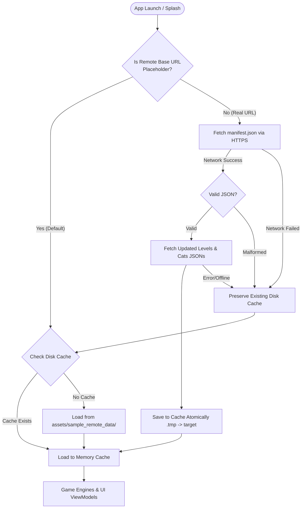

# Cozy Puzzle — GitHub Remote JSON Data System Setup Guide

Cozy Puzzle features a decoupled, data-driven architecture that loads game levels, cat collection catalogs, and balance configurations directly from GitHub Raw (or any HTTPS JSON CDN).

---

## 1. System Architecture Overview



### Key Principles
1. **100% Offline-First**: If the network is unreachable, slow, or returning errors, Cozy Puzzle uses valid cached files without interruption.
2. **Safe Fallback**: On fresh app installs before network fetch or while using the placeholder repository URL, bundled sample assets in `app/src/main/assets/sample_remote_data/` are loaded automatically.
3. **Local Progress Persistence**: Player star balances, unlocked levels, daily streaks, and coin balances remain stored strictly on the local device via Room and DataStore. Remote JSON updates never overwrite or erase player progress.
4. **Cache Protection**: Existing valid cache files are never deleted or truncated if a remote download fails or receives malformed JSON. Writes are performed atomically using temporary files.
5. **No Base64 Bloat**: Level images and cat illustrations use clean asset identifiers or standard HTTPS image URLs, keeping JSON files lightweight (< 10 KB).

---

## 2. Step-by-Step GitHub Repository Setup

### Step 2.1 — Create a GitHub Repository
1. Log in to [GitHub](https://github.com/).
2. Create a new public repository (e.g. `cozy-puzzle-data`).
3. Initialize with or without a README.

### Step 2.2 — Copy the Sample Data Files
We have pre-created the entire directory structure and validated sample files in `docs/sample_remote_data/cozy-puzzle-data/`:

```text
cozy-puzzle-data/
├── manifest.json
├── config/
│   └── game_config.json
├── levels/
│   ├── cat_puzzle.json
│   ├── color_the_cat.json
│   ├── slide_the_cat.json
│   └── find_the_pair.json
└── collections/
    └── cats.json
```

Upload these files to your repository root on branch `main`.

### Step 2.3 — Test Raw URLs in Browser
Verify your raw file URLs are accessible without authentication:
```text
https://raw.githubusercontent.com/<YOUR_GITHUB_USERNAME>/cozy-puzzle-data/main/manifest.json
```
Ensure you see the raw JSON output.

### Step 2.4 — Configure the Android App
Open `com/example/cozypuzzle/core/remote/RemoteDataConfig.kt`:

Replace `PLACEHOLDER_USERNAME`:
```kotlin
object RemoteDataConfig {
    const val PLACEHOLDER_USERNAME = "your-github-username" // Replace with your real GitHub username
    const val DEFAULT_REPO_NAME = "cozy-puzzle-data"
    const val DEFAULT_BRANCH = "main"

    @Volatile
    var rawBaseUrl: String = "https://raw.githubusercontent.com/$PLACEHOLDER_USERNAME/$DEFAULT_REPO_NAME/$DEFAULT_BRANCH/"
    ...
}
```

That is all! At runtime, `SplashFragment` and `GameRemoteDataSource` will automatically query your repository and sync levels and cat collections.

---

## 3. How to Add New Content

### 3.1 Adding a New Cat Puzzle Level
Edit `levels/cat_puzzle.json`:
```json
{
  "id": "cat_10",
  "number": 10,
  "title": "Level 10 - Starry Night",
  "difficulty": "BASIC",
  "image_url": "https://raw.githubusercontent.com/<YOUR_USER>/cozy-puzzle-data/main/assets/cat_puzzle/cat_10.png",
  "image_asset": "img_puzzle_cute_cat",
  "rows": 3,
  "columns": 3
}
```
> **Image Resolution Tip**: If `image_asset` matches an existing Android drawable (e.g. `img_puzzle_cute_cat`, `img_puzzle_space`, etc.), it loads instantly from native vector drawables.

### 3.2 Adding a New Color the Cat Level
Edit `levels/color_the_cat.json`:
```json
{
  "id": "color_cat_6",
  "number": 6,
  "title": "Level 6 - Playful Kitten",
  "difficulty": "BASIC",
  "view_box_width": 300.0,
  "view_box_height": 300.0,
  "palette": [
    "#FFB6D2",
    "#83D4F7",
    "#FFE68C",
    "#A8E6CF",
    "#FFFFFF"
  ],
  "thumbnail_asset": "img_puzzle_cute_cat",
  "regions": [
    {
      "id": "body",
      "name": "Body",
      "path_data": "M 100 180 C 70 200 70 260 105 270 L 195 270 C 230 260 230 200 200 180 Z"
    }
  ],
  "decorative_paths": [
    {
      "path_data": "M 140 160 Q 150 165 160 160",
      "stroke_color": "#1E3A5F",
      "stroke_width": 2.5
    }
  ]
}
```

### 3.3 Adding a New Slide the Cat Level
Edit `levels/slide_the_cat.json`:
```json
{
  "id": "slide_easy_6",
  "number": 6,
  "title": "Level 6",
  "difficulty": "EASY",
  "grid_size": 3,
  "image_asset": "img_puzzle_space",
  "shuffle_moves": 15,
  "three_star_moves": 22,
  "two_star_moves": 38
}
```

### 3.4 Adding a New Find the Pair Level
Edit `levels/find_the_pair.json`:
```json
{
  "id": "pair_easy_6",
  "number": 6,
  "title": "Level 6",
  "difficulty": "EASY",
  "grid_rows": 4,
  "grid_columns": 3,
  "time_limit_seconds": 120,
  "three_star_max_flips": 16,
  "two_star_max_flips": 24,
  "images": [
    "img_puzzle_cute_cat",
    "img_puzzle_cozy_room",
    "img_puzzle_little_garden",
    "img_puzzle_animals",
    "img_puzzle_picnic",
    "img_puzzle_nature"
  ],
  "thumbnail_asset": "img_puzzle_cute_cat"
}
```

### 3.5 Adding a New Cat to the Catalog
Edit `collections/cats.json`:
```json
{
  "id": "cat_daisy",
  "name": "Daisy",
  "rarity": "RARE",
  "theme_id": "GARDEN",
  "description": "Daisy loves rolling around in flower beds on warm spring mornings.",
  "image_asset": "img_cat_clover",
  "unlock_condition": {
    "type": "COMPLETE_LEVEL",
    "mode": "CAT_PUZZLE",
    "level_number": 3,
    "level_id": "cat_3"
  },
  "unlock_hint": "Complete Cat Puzzle Level 3"
}
```

Supported unlock condition types:
- `DEFAULT_UNLOCKED`: Unlocked for all new players.
- `COMPLETE_LEVEL`: Requires completing a specific level (`mode`: `CAT_PUZZLE`, `COLOR_THE_CAT`, `SLIDE_THE_CAT`, or `FIND_THE_PAIR`).
- `COMPLETE_TOTAL_LEVELS`: Requires completing `count` total levels across any mode.
- `EARN_TOTAL_STARS`: Requires accumulating `count` stars.

### 3.6 Increment `data_version` in `manifest.json`
Whenever you publish new levels or cats, bump `data_version` in `manifest.json`:
```json
{
  "schema_version": 1,
  "data_version": 2,
  "app_min_version": "1.0",
  "updated_at": "2026-10-19T00:00:00Z",
  "files": {
    "game_config": "config/game_config.json",
    "cat_puzzle": "levels/cat_puzzle.json",
    "color_the_cat": "levels/color_the_cat.json",
    "slide_the_cat": "levels/slide_the_cat.json",
    "find_the_pair": "levels/find_the_pair.json",
    "cats": "collections/cats.json"
  }
}
```

---

## 4. Troubleshooting & Best Practices

| Issue | Cause | Solution |
| :--- | :--- | :--- |
| **App continues using bundled levels** | `RemoteDataConfig` still has `PLACEHOLDER_USER` | Replace `PLACEHOLDER_USERNAME` in `RemoteDataConfig.kt` with your real GitHub username. |
| **HTTP 404 on sync** | Wrong repository name or branch | Check `DEFAULT_REPO_NAME` and `DEFAULT_BRANCH` in `RemoteDataConfig.kt`. Verify the URL opens in your browser. |
| **New levels not appearing immediately** | GitHub Raw caching or app memory cache | GitHub Raw caches CDN responses for up to ~5 minutes. Relaunch the app or increase `data_version`. |
| **JSON parse error** | Syntax error in uploaded JSON | Use a JSON validator (e.g. `jq` or jsonlint.com) before pushing changes. Existing valid disk cache will remain safe. |
